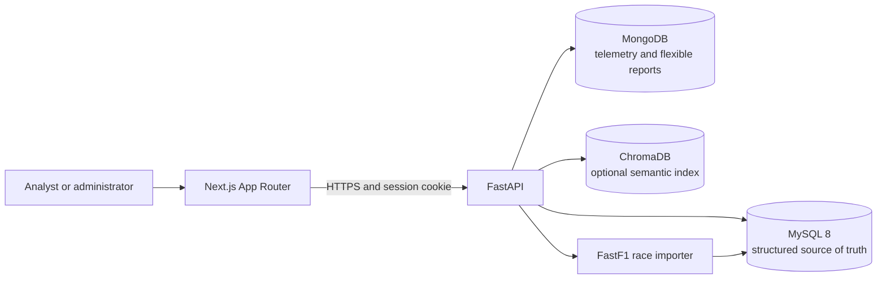

# Architecture

## Purpose

The system will combine a relational race-data core with document storage for variable, high-volume telemetry, an API that owns validation and authorization, and a browser dashboard. This extends the supplied database design reference to cover the broader project brief.

## Implemented components

## Data ownership

- **MySQL** owns normalized entities and enforceable relationships: users and permissions, drivers, constructors, season contracts, circuits, races and sessions, results, pit stops, tyre stints, strategy plans, and audit records.
- **MongoDB** owns flexible or high-frequency telemetry documents and optionally rich strategy-analysis documents. A stable MySQL identifier is stored in each document; MongoDB does not enforce MySQL foreign keys.
- **ChromaDB** is optional and derived. It indexes text for semantic discovery; it is not an authoritative record store. The system must be able to rebuild it from source documents.
- **FastF1** is an external source, not a guaranteed complete or authoritative source for every session field. The protected single-race import path retains source/provenance and validates required identifiers; authenticated live import remains unverified.

## Request and authorization path

The browser calls FastAPI, never the databases directly. FastAPI validates inputs, checks a server-side session and database-backed permissions, and calls service/repository layers. Database credentials stay in environment configuration. Production cookies are HttpOnly and secure; state-changing cookie-authenticated requests need CSRF protection. Database users should have limited grants appropriate to their service.

## Cross-database consistency

MySQL and MongoDB do not share an assumed atomic transaction. Strategy document writes validate their relational parent first. A failure between those operations can leave an orphan or incomplete state; no retry queue or reconciliation job exists yet. Deleting a MySQL parent requires explicit cleanup for related MongoDB documents. Derived vector records can be rebuilt.

## Deployment and development

The target local setup is Docker Compose for MySQL and MongoDB, with the API and frontend runnable either in containers or in their normal development environments. Optional vector search should not prevent core dashboard use. Environment files remain untracked; `.env.example` will contain placeholders only.

## Reference alignment

The supplied PDF's separation of structured results from high-volume telemetry is retained. The repository started with only a README. Local MySQL, MongoDB service setup, API reads and public-data ingestion have been exercised; unverified integrations are listed in `TESTING.md`.
