# Entity Relationship Diagram

This diagram matches the table names and relationships in `database/mysql/01_schema.sql`. MongoDB telemetry collections are documented separately because they do not have enforceable SQL foreign keys.

```mermaid
erDiagram
  drivers ||--o{ driver_team_seasons : contracts
  constructors ||--o{ driver_team_seasons : employs
  seasons ||--o{ driver_team_seasons : scopes
  seasons ||--o{ races : contains
  circuits ||--o{ races : hosts
  races ||--o{ sessions : schedules
  races ||--o| race_overtake_summaries : summarizes
  races ||--o{ race_results : records
  driver_team_seasons ||--o{ race_results : earns
  sessions ||--o{ qualifying_results : classifies
  driver_team_seasons ||--o{ qualifying_results : qualifies
  race_results ||--o{ lap_times : records
  race_results ||--o{ pit_stops : makes
  race_results ||--o{ tyre_stints : uses
  tyre_compounds ||--o{ tyre_stints : identifies
  sessions ||--o{ weather_observations : observes
  races ||--o{ strategy_plans : analyzes
  drivers ||--o{ strategy_plans : targets
  users o|--o{ strategy_plans : creates
  strategy_plans ||--o{ strategy_stints : proposes
  tyre_compounds ||--o{ strategy_stints : selects
  strategy_plans ||--o{ strategy_reports : produces
  users ||--o{ user_roles : receives
  roles ||--o{ user_roles : assigned
  users ||--o{ auth_sessions : authenticates
  roles ||--o{ role_permissions : grants
  permissions ||--o{ role_permissions : assigned
  users o|--o{ audit_logs : acts

  drivers {
    bigint driver_id PK
    varchar source_driver_key UK
    smallint driver_number
    varchar full_name
    varchar nationality
    date date_of_birth
    enum record_source
  }
  constructors {
    bigint constructor_id PK
    varchar source_constructor_key UK
    varchar name UK
    varchar country
    varchar base
    enum record_source
  }
  seasons {
    bigint season_id PK
    smallint year UK
  }
  driver_team_seasons {
    bigint driver_team_id PK
    bigint driver_id FK
    bigint constructor_id FK
    bigint season_id FK
    smallint car_number
  }
  circuits {
    bigint circuit_id PK
    varchar source_circuit_key UK
    varchar name
    varchar location
    varchar country
    decimal length_km
    enum record_source
  }
  races {
    bigint race_id PK
    bigint season_id FK
    bigint circuit_id FK
    varchar source_race_key UK
    varchar race_name
    date race_date
    enum record_source
  }
  sessions {
    bigint session_id PK
    bigint race_id FK
    enum session_type
    datetime session_date
    varchar source_session_key UK
  }
  race_results {
    bigint result_id PK
    bigint race_id FK
    bigint driver_team_id FK
    smallint position
    decimal points
    varchar status
    smallint classified_laps
    enum record_source
  }
  qualifying_results {
    bigint session_id PK,FK
    bigint driver_team_id PK,FK
    smallint position
    int q1_time_ms
    int q2_time_ms
    int q3_time_ms
  }
  lap_times {
    bigint lap_id PK
    bigint result_id FK
    smallint lap_number
    int lap_time_ms
    boolean is_personal_best
  }
  pit_stops {
    bigint pit_stop_id PK
    bigint result_id FK
    smallint stop_number
    smallint lap_number
    int duration_ms
    varchar stop_reason
  }
  tyre_compounds {
    bigint compound_id PK
    varchar name UK
  }
  tyre_stints {
    bigint stint_id PK
    bigint result_id FK
    bigint compound_id FK
    smallint stint_number
    smallint start_lap
    smallint end_lap
  }
  weather_observations {
    bigint observation_id PK
    bigint session_id FK
    datetime observed_at
    decimal air_temp_c
    decimal track_temp_c
    decimal humidity_pct
    boolean rainfall
    decimal wind_speed_kph
    varchar source
  }
  strategy_plans {
    bigint plan_id PK
    bigint race_id FK
    bigint driver_id FK
    bigint created_by_user_id FK
    varchar strategy_type
    json assumptions
    enum plan_status
    timestamp created_at
    timestamp updated_at
  }
  strategy_stints {
    bigint strategy_stint_id PK
    bigint plan_id FK
    bigint compound_id FK
    smallint stint_number
    smallint start_lap
    smallint end_lap
  }
  strategy_reports {
    bigint report_id PK
    bigint plan_id FK
    varchar title
    text report_body
    json report_metadata
    timestamp created_at
  }
  users {
    bigint user_id PK
    varchar email UK
    varchar password_hash
    varchar display_name
    boolean is_active
  }
  roles {
    bigint role_id PK
    varchar name UK
  }
  permissions {
    bigint permission_id PK
    varchar permission_key UK
    varchar description
  }
  user_roles {
    bigint user_id PK,FK
    bigint role_id PK,FK
    timestamp assigned_at
  }
  auth_sessions {
    bigint auth_session_id PK
    bigint user_id FK
    char token_hash UK
    char csrf_hash
    datetime expires_at
    datetime revoked_at
  }
  role_permissions {
    bigint role_id PK,FK
    bigint permission_id PK,FK
  }
  audit_logs {
    bigint audit_id PK
    bigint actor_user_id FK
    varchar action
    varchar entity_type
    varchar entity_key
    timestamp occurred_at
    json details
    char request_id
  }
  import_runs {
    bigint import_run_id PK
    varchar source
    smallint season_year
    varchar event_name
    varchar session_type
    enum status
    timestamp started_at
    timestamp completed_at
    int rows_written
    varchar error_summary
  }
  race_overtake_summaries {
    bigint race_id PK,FK
    bigint source_session_key UK
    int overtake_count
    varchar source
    timestamp fetched_at
  }
```

The cross-season rule connecting each race result to a season-valid driver contract is enforced by MySQL triggers in `12_routines_and_triggers.sql`, because it spans two referenced relations. MongoDB stable IDs and collection schemas are shown in `MONGODB_DESIGN.md`.
