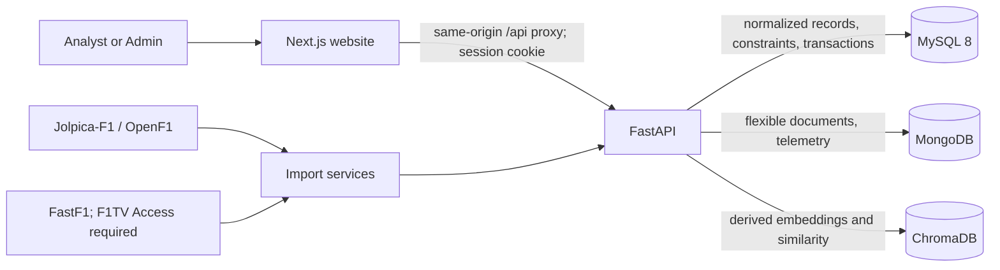

# Teammate Brief and Complete Demo Walkthrough

This is the handoff document for explaining the project, navigating the website, demonstrating the database deliverables, and answering the main design questions. It describes the current implementation and its real data coverage. The deeper source documents are linked at the end.

## 1. Project in one minute

**F1 Race Strategy and Performance Intelligence** is a database-backed web application for exploring historical Formula 1 results and race performance. The Next.js website presents the data; a FastAPI service validates requests, enforces login and database-backed roles, runs queries and writes; MySQL stores normalized race facts; MongoDB stores flexible documents and telemetry; ChromaDB is an optional derived vector index for semantic search over reports.

The key database design decision is to use each database for the data shape it handles well. MySQL is the authoritative store for facts that must join reliably and obey keys, constraints and transactions. MongoDB is for nested or variable-shape telemetry and flexible strategy documents. ChromaDB stores embeddings for similarity search and can be rebuilt from reports; it is not the authoritative copy. The browser never connects directly to any database.

**Short pitch:** “We built an F1 analytics workspace that combines a normalized relational race database with document and vector storage, exposes it through a permission-checked API, and lets users explore results, compare drivers, analyze races, estimate strategies, and administer data.”

## 2. What is in the current dataset

The checked local dataset includes seasons 2018–2025: 173 races, 3,458 classifications, 5,941 pit-stop rows, and 3,455 qualifying classifications. Detailed lap timing is available for 2024 (26,574 rows); imported seasons do not all have the same detail. OpenF1 overtake counts cover 70 races in 2023–2025 (17,589 events); 2019–2022 have no overtake source coverage. Tyre compounds/stints and high-frequency FastF1 telemetry are not populated in the checked dataset. A checked 2024 analysis event showed 1,033 lap rows and 28 pit stops, and zero tyre-stint rows.

Do not present unavailable coverage as zero race activity or fabricate sample values. The dashboard and pages should expose gaps as missing or empty data. Hypothetical strategy estimates are models, not historical outcomes.

## 3. Architecture and request flow

1. A page fetches `/api/...` from the same Next.js origin. Next.js forwards to FastAPI on port 8001. This keeps cookies same-origin for both `localhost` and `127.0.0.1` use.
2. FastAPI validates request data with Pydantic schemas. Protected handlers load the server-side session and check permission keys resolved through MySQL roles/permissions.
3. Repository/route code reads or mutates MySQL and/or MongoDB. The API sends JSON back to the page.
4. Semantic report search embeds text locally and searches the persistent Chroma collection; the report itself remains in MySQL.

MySQL and MongoDB do not share a transaction. Strategy-document writes first check the parent plan in MySQL and then write the Mongo document; cross-store cleanup/reconciliation is a known design limitation. Chroma is derived and can be rebuilt. Secrets stay in `.env`; never show or commit its contents.

## 4. Why these technologies and databases

| Technology | Role in this project | Why it fits / trade-off |
|---|---|---|
| MySQL 8 | Structured source of truth for seasons, races, circuits, drivers, constructors, season contracts, results, sessions, laps, pit stops, strategy plans, users and audit | Foreign keys, uniqueness, checks, transactions, joins, views, CTEs and stored-program support. Requires a defined schema. |
| MongoDB | Flexible strategy documents and telemetry collections | Documents can contain nested or varying measurement shapes. It cannot enforce MySQL foreign keys, so the API validates stable parent IDs. |
| ChromaDB | Derived semantic index over strategy report text | Similarity search by meaning complements exact SQL filters. It is not a replacement for SQL/Mongo data and can be rebuilt. The embedding model has a first-use download. |
| FastAPI + SQLAlchemy + Pydantic | API, relational access and validation | Python ecosystem aligns with data processing and FastF1; typed schemas make request/response contracts explicit. |
| Next.js + TypeScript | User interface and same-origin API proxy | App Router pages and typed UI components; database access and authorization stay on the server. |
| Argon2id + server-side sessions | Password hashing and revocable login state | Passwords are salted hashes, browser gets an opaque session cookie, and permission checks happen server-side. |
| Jolpica-F1 / OpenF1 / FastF1 | Public historical results, overtake events, protected detailed session source | Different source coverage and access conditions are kept visible. Public imports do not imply protected F1TV timing access. |

### Why “mix” databases?

This is purposeful polyglot persistence, not duplicated authority. Results and relationships need relational guarantees, so they belong in MySQL. Telemetry and flexible reports may have nested or evolving fields, so MongoDB fits them. Semantic nearest-neighbor lookup needs vector indexing, so Chroma stores derived embeddings. Each API feature uses its appropriate store; users use one website and do not choose databases directly.

## 5. ER diagram and relational schema explanation

Open [`ER_DIAGRAM.md`](ER_DIAGRAM.md), then [`RELATIONAL_SCHEMA.md`](RELATIONAL_SCHEMA.md). Walk through this chain:

`seasons → races → race_results → driver_team_seasons → drivers + constructors`

- `race_results` is a fact: one entrant's outcome in one race. It references the event and the season-specific driver/team contract.
- `driver_team_seasons` resolves which constructor and car number a driver represented in a season. It handles team changes and substitute drivers; a driver can have more than one contract in one season.
- `lap_times`, `pit_stops`, and `tyre_stints` are dependent facts beneath a race result. They do not repeat driver and event descriptions on every measurement.
- `sessions` group qualifying/practice/race session metadata under a race; `qualifying_results` associates a session and season contract.
- `strategy_plans → strategy_stints → strategy_reports` stores estimates and generated report text. A strategy plan is not an observed race result.
- `users ↔ roles ↔ permissions` is many-to-many authorization. `auth_sessions` stores session token hashes and expiry/revocation. `audit_logs` preserve administrative actions.

**Keys and constraints to point at:** primary keys identify rows; unique source keys prevent duplicate imports; foreign keys prevent orphan facts; composite unique keys prevent duplicate entrant results and contracts; `CHECK` constraints bound values such as positive lap numbers and valid ranges; enumerated fields restrict statuses/session types; indexes support common season, race, driver, and foreign-key lookups. Referential actions cascade dependent measurements where appropriate and restrict deleting referenced reference data. Cross-table season correctness cannot be guaranteed by a single-row `CHECK`, so triggers validate that a result/qualifying entry/strategy plan uses a driver contract from the same season as its race.

**Normalization explanation:** driver identity, constructor identity, season contract, circuit and race descriptions are stored once and referenced by keys. This reduces update anomalies and makes joins explicit. Flexible telemetry is intentionally not forced into a wide relational table.

## 6. SQL deliverables: what each query demonstrates and why

The runnable examples are in `database/mysql/10_query_demonstrations.sql`; narrative and statuses are in [`SQL_CONCEPTS.md`](SQL_CONCEPTS.md). Show the SQL file and explain these patterns:

| Query/concept | What it does here | Why use it |
|---|---|---|
| INNER / multi-table JOIN | Connects race result to race, season, driver, and constructor | Foreign-key path assembles a readable fact from normalized tables. |
| LEFT JOIN + aggregation | Keeps all selected drivers, including those with no result, and counts starts/points | An INNER JOIN would discard unmatched drivers; `COUNT(child_pk)` counts only matches. |
| Nested subquery | Filters drivers who have at least one win; another nested aggregate compares average finishing position with a field average | A query result can be used as a set or scalar condition for an outer query. |
| Correlated subquery | Finds the fastest available lap per race; another finds pit stops slower than that race's mean | Inner query refers to the current outer race, so the comparison is event-specific. |
| Nonrecursive CTE | Names a per-driver/per-season points and average-finish intermediate result | Improves readability and allows filtering/ordering derived aggregates. |
| Window functions | Ranks lap pace and computes race/lap mean and previous-lap delta with `RANK`, `AVG OVER`, `LAG` | Adds comparison columns without collapsing each driver's lap into a group. |
| Recursive CTE | Generates lap numbers from 1 up to observed maximum for a selected race | Demonstrates anchor + recursive step + stopping condition; useful for a complete lap grid. |
| DML + transaction | Select/insert/update/delete on clearly named demo rows, then roll back | Demonstrates transactional safety and leaves no lasting demo mutation. The current script was run and baseline counts stayed unchanged. |
| Views (`11_views.sql`) | Driver-season standings and per-race pit-stop summary | Encapsulates reusable SQL; view is not a copied source dataset. |
| Function (`12_routines_and_triggers.sql`) | `fn_average_lap_ms(result_id)` computes an average lap time in milliseconds | Server-side reusable scalar calculation; NULL handling reflects missing lap times. |
| Procedure (`12_routines_and_triggers.sql`) | `sp_driver_season_summary(driver_id, year)` returns the selected driver's season summary | Demonstrates parameterized server-side multi-column result retrieval. |
| Triggers (`12_routines_and_triggers.sql`) | Validate season-contract consistency on result/qualifying/plan insert and update; audit strategy-plan updates | Enforces cross-table business rules and centralized change logging where simple checks cannot. |
| Migration (`13_driver_team_transfers.sql`) | Adds support for driver/team transfers within a season while preserving existing contracts | Demonstrates a repeatable schema/data evolution for substitute drivers. |
| Overtake summary (`14_race_overtake_summaries.sql`) | Stores one source summary per race; NULL/missing is distinct from a measured zero | Makes source coverage explicit, instead of guessing absent values. |

`DELIMITER` in routine SQL is a MySQL command-line client directive that lets the client submit a stored program body; it is not sent as a server SQL statement. DDL/query demonstrations are recorded as executed on local MySQL 8.4. For a live talk, use read-only queries on the populated database; never rerun initialization. DML examples were verified to roll back.

## 7. NoSQL and vector deliverables

### MongoDB

`database/mongodb/01_collections_and_indexes.js` defines collection validators and indexes. `database/mongodb/02_rud_and_aggregation_demo.js` uses isolated reserved synthetic IDs, performs create/read/update/delete and an aggregation, then removes only its own fixtures. Explain that stable SQL IDs link documents logically, but MongoDB cannot enforce relational foreign keys. Current relevant collection names include `laps_telemetry`, `session_telemetry_stream`, `weather_conditions`, and `strategy_documents`.

Strategy-document API flow: check the corresponding plan in MySQL → create/read/update/delete the flexible document in MongoDB → return JSON. This is why route validation exists at the boundary. Be transparent that cross-database writes are not one atomic transaction.

### ChromaDB

The vector collection indexes report text from SQL reports using the local `all-MiniLM-L6-v2` embedding function and cosine distance. “Index reports” rebuilds/refreshes derived vectors; “Search” embeds the user's text and ranks similar report documents. Metadata (report/race/driver/strategy) helps identify the source. The cosine distance is a ranking distance, not a confidence or truth score. The checked local collection has three current report vectors. First indexing can download/cache the model.

## 8. Website walkthrough: all pages and main functions

Start on the home page and explain the top navigation. Move through the sequence below. API behavior and access detail are in [`API_DOCUMENTATION.md`](API_DOCUMENTATION.md).

| Page | What to click/show | Data/API and database explanation |
|---|---|---|
| `/` Dashboard | Season champion cards, coverage/summary metrics, podiums and overtake summaries | Calls dashboard/season analytics endpoints; aggregate queries read MySQL. Coverage badges describe which source has detail. |
| `/drivers` | Search/browse driver list; open comparison | Driver endpoint reads MySQL reference/summary rows. |
| `/constructors` | Browse constructors | Constructor summaries derive from MySQL results and constructor references. |
| `/compare` | Select drivers (up to four) and optional season; run comparison | `driver-comparison` aggregates starts, points, average finish, wins and poles from MySQL. Explain filters and aggregate semantics. |
| `/races` | Search/filter imported race events; open an event | `GET /api/races` is paginated; source, counts and available overtake metadata are MySQL-backed. |
| `/races/{raceId}` | View classification, constructor, points, status and source | `GET /api/races/{race_id}/results` joins result, driver/team and event data. Provenance shows where rows came from. |
| `/analysis` | Select a race; switch Results / Lap times / Pit stops / Tyre stints tabs | Result, lap, pit, and stint API reads from MySQL. Lap endpoint uses window analytics; only show available source data. The checked 2024 event has lap and pit-stop rows; tyre-stint view is empty. |
| `/track-layouts` | Change season, search/select circuit, inspect outline/unmatched state | Circuit metadata and season coverage come from MySQL; outline geometry is matched from a public GeoJSON asset by normalized names. Explain a layout may be unmatched or length unavailable. |
| `/strategy` | Pick an actual race entrant, set/compare strategy assumptions, submit | Protected strategy compare API validates the entrant, uses a recorded average lap baseline when available (or labeled fallback/input), and persists one/two-stop plans/stints in MySQL transactionally. The result is hypothetical and does not model weather, traffic or actual compounds. |
| `/reports` | Browse saved strategy reports | Reads report rows from MySQL; show report provenance/plan linkage. |
| `/search` | Search by meaning; optionally refresh/index reports | FastAPI builds Chroma embeddings from report text and performs cosine similarity search. Explain derived store and first-run model download. |
| `/login` | Sign in with a prepared Analyst or Admin test account | FastAPI verifies Argon2id hash, creates opaque DB-backed session and CSRF cookie. Do not create credentials live unless prepared. |
| `/register` | Explain self-registration | New registration is restricted to Analyst. The client cannot self-assign Admin. Better to explain than create a new demo account during presentation. |
| `/admin/users` | As Admin, list accounts, create a test user, grant/revoke roles; view audit if available | Permission-guarded API; users/roles/permissions/session/audit are MySQL. Show denied analyst access (403) with a preprepared Analyst account. |
| `/admin/data` | Explain controlled manual race classification create/edit/delete | MySQL `race_results`, provenance, constraints, audit log. Only perform CRUD on a disposable/test fixture; do not alter imported demo records. |
| `/admin/sessions` | Explain session metadata CRUD and dependent qualifying count | MySQL sessions and qualifying entries; session deletion behavior does not delete race classifications/lap data. Keep the live demo read-only. |
| `/admin/imports` | Show import history and public Jolpica season import controls | Import-run lifecycle and imported records are MySQL. Public completed-season data uses Jolpica; do not start a large import during a timed demo. FastF1 protected source requires F1TV Access. |

### UI/auth behavior to narrate

- Loading and empty states are meaningful: empty means this source did not supply rows for that view, not that F1 had no such event.
- Errors should be shown as user-safe messages, not database exceptions.
- Analysts use read/analysis/strategy features according to granted permissions. Admin pages and write endpoints require server-side permission checks; hiding a navigation link is not the security control.
- Login session is stored server-side, the browser has an opaque cookie, and mutations require CSRF protection. The API proxy keeps this session same-origin.

## 9. Suggested 15-minute demo script

### Before the audience arrives

1. Confirm this is the intended repo/branch and that `.env` exists without opening or displaying its secrets.
2. Start the already existing Compose services only: `docker compose up -d mysql mongodb`. Do not delete volumes, run schema setup, or seed the populated DB.
3. In separate terminals, start backend: `cd backend`, activate `.venv`, `uvicorn app.main:app --reload --port 8001`; start frontend: `cd frontend`, `npm run dev`.
4. Open `http://localhost:3000` and optionally `http://localhost:8001/docs`. Confirm prepared Admin and Analyst login in advance. Check the primary dashboard, analysis event, and report search before presentation.
5. If database/API/container startup fails, do not initialize/reset live data. Use the design docs and recorded verification, and clearly call the feature not live in that moment.

### Talk track

**0:00–1:00 — Problem and value**  
“F1 data is spread across season results, race/session measurements, and strategy notes. Our goal was to make historical performance inspectable and demonstrate database design beyond a single table. The current app uses historical imported data; the strategy comparison is a transparent estimate.”

**1:00–3:00 — ER/schema and tech choices**  
Open `ER_DIAGRAM.md` and `RELATIONAL_SCHEMA.md`. Trace season → race → result → season contract → driver/constructor, and result → lap/pit/stint. Point out keys, constraints and the trigger enforcing season consistency. Then use the tech table above to explain MySQL vs MongoDB vs Chroma.

**3:00–6:00 — Website exploration**  
Dashboard → Drivers/Constructors → Compare → Races → open a race → Analysis. Show at least one result table, lap view, and pit view. Click tyre stints and state the checked race currently has none. Use the season coverage view to explain why 2024 lap data is present while other years may be sparse.

**6:00–8:00 — Track and strategy**  
Open Track layouts and select a circuit. Open Strategy, select an entrant, compare the one-stop/two-stop outputs. Explain baseline and assumptions; label it hypothetical. Open Reports and then Search; run a semantic query and explain that vectors rank related prose, while the canonical report remains in MySQL.

**8:00–10:00 — Authentication and Admin**  
Show Analyst login and `/api/auth/me` if convenient. Try an admin URL as Analyst and show the access denial. Sign into a separately prepared Admin account and show user/import/data/session consoles without mutating imported records. Explain that registration grants Analyst only and permissions are checked by FastAPI against MySQL.

**10:00–13:00 — SQL and NoSQL concepts**  
Open `SQL_CONCEPTS.md` and `10_query_demonstrations.sql`. Explain one multi-table join, LEFT JOIN, nested query, correlated query, CTE, recursive CTE, and window functions. Point to views, the function, procedure, and triggers. Explain the DML transaction ends with rollback. Show Mongo validator/index and the synthetic RUD/aggregation script; point out fixture cleanup. Avoid executing destructive/fixture scripts during live demo unless a separate disposable environment has been confirmed.

**13:00–15:00 — Limitations and wrap-up**  
Explain honest source limits: detailed laps are concentrated in 2024; OpenF1 overtake data starts in 2023 and its event definition includes recorded position changes around pit/penalty events; tyre/weather/high-frequency telemetry are not populated; FastF1 protected timing requires F1TV Access. End at `DELIVERABLE_TRACEABILITY.md` and `TESTING.md` for evidence and known verification limits.

## 10. Safe demo rules

- This checkout already contains valuable database rows. Do not run `00_create_database.sql`, `01_schema.sql`, `02_reference_and_synthetic_seed.sql`, or full initialization against its populated volume.
- Do not delete/recreate Docker volumes, overwrite `.env`, or run destructive SQL against the demo DB.
- Keep manual CRUD demonstrations on isolated disposable fixtures. The prior readiness checks used temporary records and cleaned them; that does not make a real imported result safe to edit.
- MySQL DML examples use a transaction and rollback, but still verify the selected schema/connection first. Prefer disposable MySQL for an academic live query run.
- Mongo example uses reserved synthetic IDs and cleanup filters. Inspect output and verify it removed only its fixture.
- Avoid a first-time Chroma model download during a timed presentation. Pre-warm and confirm the vector search in advance.
- Never claim FastF1 import worked unless the authenticated live request actually succeeded in the demo.

## 11. Common viva questions and short answers

**Why not store everything in MySQL?**  
Core facts need referential integrity and structured joins. Variable nested telemetry/documents evolve more naturally in MongoDB. Avoiding a huge sparse relational measurement table is a trade-off, and the API must validate cross-store identifiers.

**Why not store everything in MongoDB?**  
Race classifications, season contracts, user roles and audit facts benefit from foreign keys, uniqueness, transactional updates and relational queries. MongoDB cannot enforce those same SQL relationships across collections.

**Why a vector DB?**  
Exact SQL filters answer structured questions; embedding similarity finds reports with related meaning even when they use different words. Chroma is derived, optional and rebuildable, not the source of truth.

**How is RBAC enforced?**  
Argon2id hashes passwords. The server stores session token hashes and revocation/expiry state. Permission grants are relational rows. FastAPI checks the session and required permission on protected routes; frontend visibility is only presentation.

**Why triggers for season correctness?**  
The rule depends on the season of two referenced records. A simple row-level `CHECK` cannot join other tables, so triggers check the referenced season contract at insert/update time.

**What is the difference between correlated and nested queries?**  
A nested subquery can be independent and produce a set/scalar for the outer query. A correlated subquery references a current outer row (here the race) and is evaluated in that context.

**What do window functions add?**  
They calculate rank/mean/previous value across a partition while retaining each lap row. `GROUP BY` would collapse the individual laps.

**Are the strategy results race predictions?**  
No. They are scenario estimates based on the selected entrant's recorded mean lap when available and explicit assumptions. They do not model the complete race state such as traffic, weather, or actual tyre degradation.

**Why are some analysis tables empty?**  
Source coverage differs by year and data type. Empty tyre stints mean no compound/stint source rows were imported, not that the race had no tyre changes.

## 12. Source files to keep open during handoff

- Project/architecture: [`README.md`](../README.md), [`ARCHITECTURE.md`](ARCHITECTURE.md), [`TECHNOLOGY_JUSTIFICATION.md`](TECHNOLOGY_JUSTIFICATION.md)
- Requirements and schema: [`REQUIREMENTS.md`](REQUIREMENTS.md), [`ER_DIAGRAM.md`](ER_DIAGRAM.md), [`RELATIONAL_SCHEMA.md`](RELATIONAL_SCHEMA.md), [`DATA_DICTIONARY.md`](DATA_DICTIONARY.md), [`NORMALIZATION.md`](NORMALIZATION.md)
- API/security: [`API_DOCUMENTATION.md`](API_DOCUMENTATION.md), [`AUTHENTICATION_AND_RBAC.md`](AUTHENTICATION_AND_RBAC.md)
- SQL/NoSQL/vector: [`SQL_CONCEPTS.md`](SQL_CONCEPTS.md), `../database/mysql/10_query_demonstrations.sql`, `../database/mysql/11_views.sql`, `../database/mysql/12_routines_and_triggers.sql`, [`MONGODB_DESIGN.md`](MONGODB_DESIGN.md), `../database/mongodb/02_rud_and_aggregation_demo.js`, [`VECTOR_DATABASE.md`](VECTOR_DATABASE.md)
- Presentation evidence: [`DEMO_SCRIPT.md`](DEMO_SCRIPT.md), [`TESTING.md`](TESTING.md), [`DELIVERABLE_TRACEABILITY.md`](DELIVERABLE_TRACEABILITY.md), [`VIVA_QUESTIONS.md`](VIVA_QUESTIONS.md)
- Website source: `../frontend/src/app/`; API source: `../backend/app/routers/`; ingestion: `../backend/app/ingestion/`.
